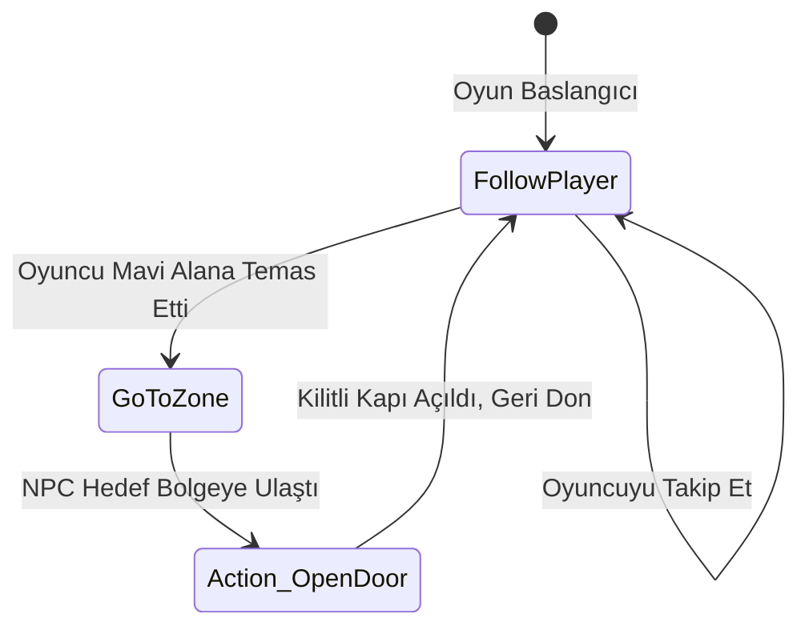
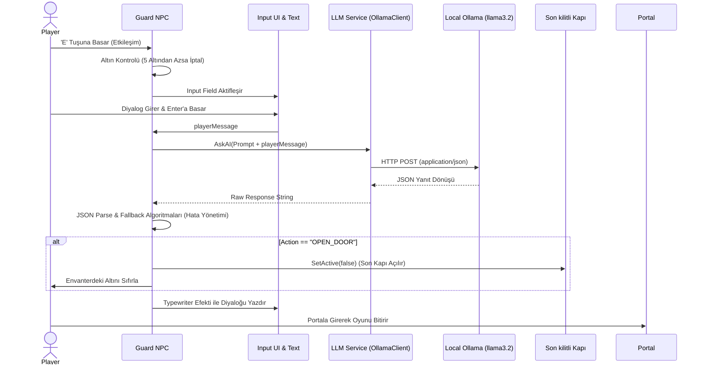

# 2D AI Companion & LLM NPC Entegrasyon Projesi

## Navigator

1. [Problemin Tanımı, Amaç ve Genel Oyun Senaryosu](#1-problemin-tanımı-amaç-ve-genel-oyun-senaryosu)
2. [Otonom Companion NPC: Durum ve Davranış Mantığı](#2-otonom-companion-npc-durum-ve-davranış-mantığı)
3. [LLM Entegrasyon Mimarisi ve Sistem Tasarımı](#3-llm-entegrasyon-mimarisi-ve-sistem-tasarımı)
4. [Hata Yönetimi Stratejisi (Error Handling)](#4-error-handling)
5. [Test Senaryoları ve Sonuçları](#5-test-senaryoları-ve-sonuçları)
6. [Sonuçlar](#6-sonuçlar)
7. [Oyun içi Görseller](#7-oyun-içi-görseller)
8. [Kullanılan Kütüphaneler](#8-kullanılan-kütüphaneler)

## 1. Problemin Tanımı, Amaç ve Genel Oyun Senaryosu

**Problem Tanımı:** Geleneksel NPC diyalogları ve davranışları genellikle önceden yazılmış, statik karar ağaçlarına dayanır. Bu durum oyuncunun yaratıcılığını sınırlar ve tekrar oynanabilirliği düşürür.

**Amaç:** NavMesh sayesinde otonom hareket eden bir Companion NPC ile oyuncuya mekanik destek sağlamak; aynı zamanda yerel bir LLM kullanarak oyuncunun yazışarak ikna edebileceği dinamik, rol yapabilen bir Guard NPC oluşturmak.

**Oyun Senaryosu ve Oynanış:** Player ve ona eşlik eden NPC, oyuna haritanın en alt kısmından başlar. İlerleyebilmek için oyuncunun haritadaki mavi NPC'nin yeşil renkle belirtilmiş özel alanlara girmesi ve geçişi engelleyen kilitli kapıları açtırması gerekir.

Zindan boyunca yer alan dikenlerden kaçınarak haritaya dağıtılmış olan toplam 5 altını toplamaları şarttır. Bu altınlar toplandıktan sonra, haritanın sağ üst köşesinde bekleyen Guard NPC ile iletişime geçilir. Oyuncu, topladığı altınları rüşvet olarak sunarak veya Guard'ı  ikna ederek son kilitli kapıyı açtırmalıdır. Son kapı açıldığında, oyuncu portala girerek oyunu başarıyla tamamlar.

## 2. Otonom Companion NPC: Durum ve Davranış Mantığı

Companion NPC (`npc_movement.cs`), Unity'nin NavMeshAgent sistemini kullanarak 2D düzlemde hareket eder. Davranışları belirli durumlara  ayrılmıştır:

- **FollowPlayer:** Varsayılan durumdur. Oyuncu ile arasındaki belirli bir mesafeyi (`followDistance`) koruyarak sürekli oyuncuyu takip eder.
- **GoToZone:** Oyuncu mavi veya yeşil bir ZoneSensor'ü tetiklediğinde NPC bu duruma geçer ve hedef bölgeye (`zoneTarget`) ilerler. Bölgeye ulaştığında eşleşen kilitli kapıyı (Door) açar ve tekrar oyuncuyu takip etmeye başlar.
- **WaitingAtZone:** Bekleme durumudur (Gelecekteki genişletmeler için rezerve edilmiştir).

### Companion NPC State Diagram



## 3. LLM Entegrasyon Mimarisi ve Sistem Tasarımı

Sistem, `llama3.2` modelini koşturan local bir Ollama sunucusuna HTTP POST istekleri (`http://localhost:11434/api/generate`) atarak çalışır.

**Kullanılan Algoritmalar/Modeller:**

- **LLM Motoru:** Ollama (Llama 3.2 Modeli)
- **İletişim:** UnityWebRequest (Asenkron HTTP REST)
- **Veri Formatı:** JSON 

### System Prompt ve NPC Kişiliği

Guard NPC'nin kişiliği açgözlü, dramatik ve komik bir ortaçağ fantastik muhafızı olarak belirlenmiştir. Prompt içinde oyuncunun envanterindeki altın bilgisi dinamik olarak LLM'e sunulmaktadır.

- **System Prompt:** `"You are a greedy, dramatic, and humorous medieval fantasy guard NPC in a 2D game. The player is trying to convince you to open the door. Player's current gold in inventory: [CURRENT_GOLD]. (Hedef: 5 Altın) Player's message: '[PLAYER_MESSAGE]'`

  **Instructions:**
  - Be easily persuaded! If the player attempts any form of bribery, clever argument, or good roleplay, you should happily agree to let them pass.
  - If you decide to let them pass, set action to OPEN_DOOR. Otherwise, set action to NONE.
  - Write your dialogue response in English, staying in character.

  **CRITICAL:** Output MUST be strictly valid JSON format with keys dialogue and action, with no extra text or markdown formatting: `{ "dialogue": "Your response here", "action": "OPEN_DOOR" }"`

### JSON Schema

LLM'den beklenen yanıt şeması, C# tarafında parse edilebilmesi için şu sınıfa bağlanmıştır:

```json
{
  "dialogue": "string (NPC'nin oyuncuya vereceği yanıt)",
  "action": "string ('OPEN_DOOR' veya 'NONE')"
}
```

### LLM İstek / Yanıt Akış Şeması



## 4. Error Handling

LLM entegrasyonlarında en büyük sorun modelin istenen formata (JSON) uymaması veya sunucu bağlantı sorunlarıdır. Projede çok katmanlı bir hata yönetimi stratejisi izlenmiştir:

- **Timeout Hataları:** `OllamaClient.cs` içerisinde UnityWebRequest timeout parametresi kullanılmıştır. Sunucu yanıt vermezse Catch bloğu devreye girer ve `"Go away!"`  gibi oyun içi evrenle uyumlu yedek diyaloglar gösterilir.
- **JSON Formatı Temizleme:** Model JSON yerine Markdown kod blokları (```json ... ```) döndürürse, `GuardNPC.cs` içindeki dize işleme metotları bu fazla karakterleri temizleyerek sadece süslü parantez `{ }` içindeki veriyi izole eder.
- **Regex / Fallback (B Planı):** Eğer `JsonUtility.FromJson` işlemi parse hatası verirse (model tamamen yapıyı bozarsa), yanıtın ham hali ekrana basılır. Kapının açılıp açılmaması ise ham metin üzerindeAnahtar kelime taraması ile belirlenir (`"OPEN_DOOR"`, `"YOU MAY PASS"`, vb. kelimeler aranır, oyuncunun `"DON'T"` gibi itirazları filtrelenir).

## 5. Test Senaryoları ve Sonuçları

| Test Senaryosu | Beklenen Durum | Sonuç (Başarı Durumu) |
| :--- | :--- | :--- |
| **Birim Testi: Altın Toplama** | Oyuncu objesi Coin ile temas ettiğinde Coin kaybolmalı ve Envanter UI güncellenmeli. | Başarılı. Ses efekti çalışıyor, miktar güncelleniyor. |
| **Entegrasyon: Mavi/Yeşil Alanlar** | Oyuncu renkli trigger alana girdiğinde NPC'nin hedefe gidip kilitli kapıyı açması. | Başarılı.  NavMesh düzgün çalışıyor. |
| **Dikenler** | Spike objesine çarpıldığında oyuncu ve NPC haritanın en altına dönmeli, açılan kilitli kapılar kapanmalı. | Başarılı. `ResetLevel()` tam donanımlı sıfırlama yapıyor. |
| **LLM Test 1: Yetersiz Bakiye** | 5 Altından az varken Muhafız ile konuşulmaya çalışılması. | Başarılı. AI isteği atılmadan Guard direkt "You do not have enough gold!" diyerek engelliyor. |
| **LLM Test 2: İkna Başarılı** | Oyuncu 5 altına sahipken "İşte altınların, beni içeri al" demesi. | Başarılı. Model OPEN_DOOR döndürüyor, son kilitli kapı siliniyor, altın sıfırlanıyor. |
| **Bitiş (Endgame) Testi** | Son kapıdan geçip siyah portala temas edilmesi. | Başarılı. Bitiş ekranı açılıyor ve X tuşu ile oyun kapanıyor. |

## 6. Sonuçlar

### Başarılar

- Localhost üzerinden sıfır maliyetli ve güvenli bir LLM entegrasyonu sağlandı (`OllamaClient` warmup rutini sayesinde ilk gecikmeler minimize edildi).
- Companion NPC, NavMesh ile dinamik çevre takibi yaparak oyuna bulmaca elementleri ZoneSensor'ler kazandırdı.
- Model yanıtlarını işlemek için kurulan sağlam error handling mimarisi sayesinde JSON kırılmaları oyunun çökmesine veya kilitlenmesine engel oldu.

### Sorunlar

- **Performans & Donanım:** Ollama ve llama3.2'nin local'de çalışması ciddi bir ram ve gpu gereksininmi doğurmaktadır.

## 7. Oyun içi Görseller


## 8. Kullanılan Kütüphaneler:

https://github.com/h8man/navmeshplus : 2D projelerde Unity NavMesh Agent kullanımını ve Tilemap NavMesh Baking sağlamak amacıyla projeye entegre edilmiştir.

 
